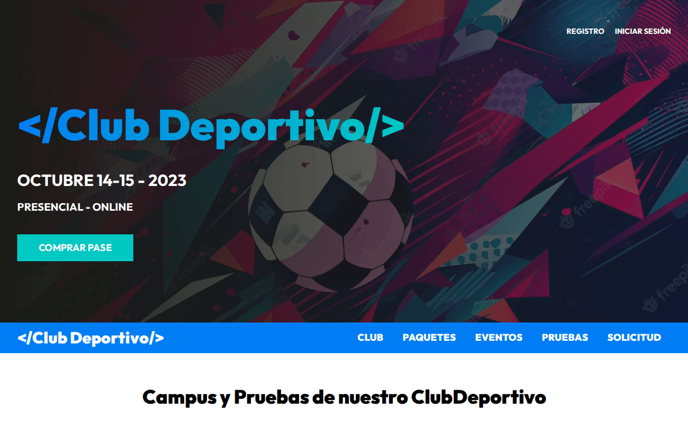
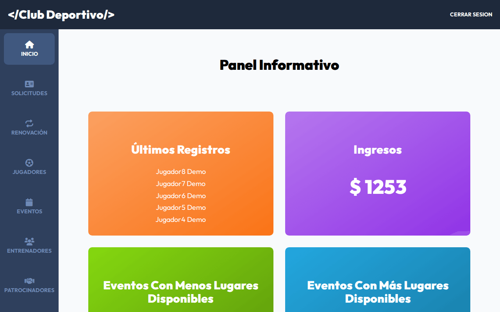
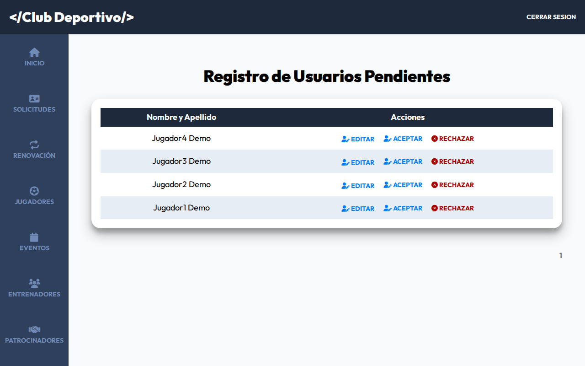
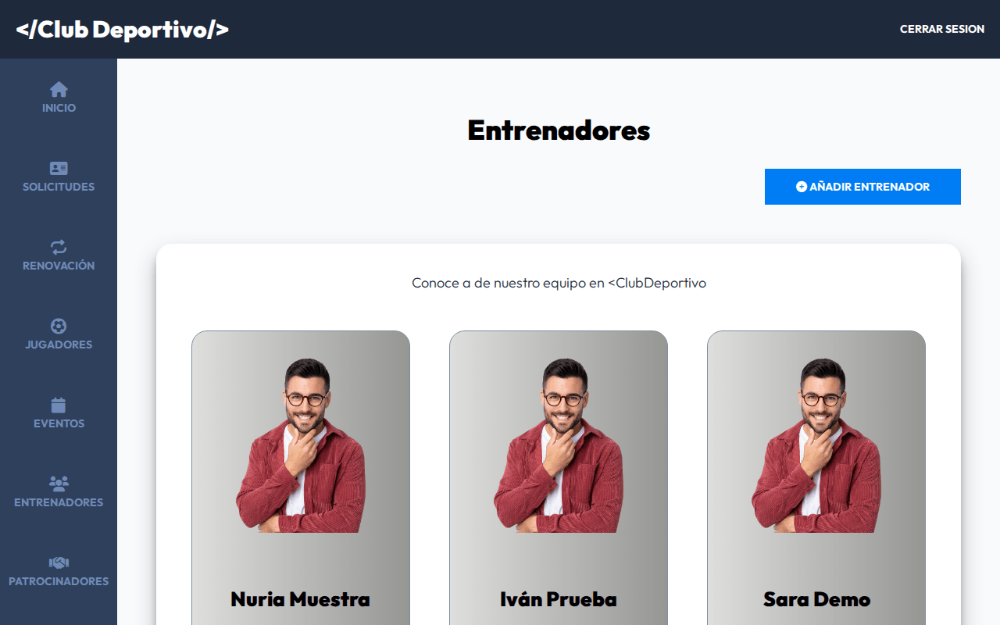

# DevClubDeportivo · Gestión de un club deportivo en PHP MVC

> **Proyecto de formación ampliado.** Parte del proyecto final *DevWebCamp* del curso
> *Desarrollo Web Completo* de Juan Pablo De la Torre Valdez
> ([Código Con Juan](https://codigoconjuan.com)) y lo adapta a un club deportivo con
> módulos nuevos: jugadores, entrenadores, patrocinadores, equipación, renovaciones y
> firma de autorizaciones.


Aplicación web para un club deportivo: web pública con torneos y campus, alta de jugadores
con aprobación del club, pago de la inscripción y un panel de administración para gestionar
solicitudes, entrenadores, eventos, patrocinadores y equipación.

## Funcionalidades

- **Web pública:** portada con torneos y campus, entrenadores, patrocinadores por rango
  (oro / plata), mapa (Leaflet) y páginas de club, paquetes, eventos y pruebas.
- **Alta de jugadores:** registro con ficha completa (datos personales, tutores, categoría,
  federado, alergias…), confirmación por email y **aprobación manual** desde el panel.
- **Autorizaciones con firma:** el jugador firma las autorizaciones y el sistema envía a
  cada tutor un enlace con token para confirmarlas, con el documento de tratamiento de
  datos adjunto.
- **Renovaciones:** el jugador solicita la renovación y el administrador la acepta o rechaza.
- **Inscripción y pago:** paquetes con pago mediante el SDK de PayPal, elección de eventos
  con control de plazas y equipación.
- **Panel de administración:** dashboard, solicitudes pendientes (con edición de la ficha),
  renovaciones, inscritos y CRUD de eventos, entrenadores (con subida de imagen), patrocinadores y equipación.
- **APIs JSON:** `/api/eventos-horario`, `/api/entrenadores`, `/api/entrenador`, `/api/equipacion`.

## Capturas

| Portada | Panel de administración |
|---|---|
|  |  |
| **Solicitudes pendientes** | **Entrenadores** |
|  |  |

*Capturas tomadas en local con datos de ejemplo ficticios.*

## Stack

- **Backend:** PHP 8 con MVC propio (router, `ActiveRecord` sobre mysqli), paginación propia.
- **Base de datos:** MySQL / MariaDB.
- **Frontend:** JavaScript sin frameworks empaquetado con webpack-stream, Sass con BEM, Gulp
  (imágenes WebP y AVIF), Swiper, SweetAlert2, AOS y Leaflet.
- **Dependencias PHP:** `phpmailer/phpmailer`, `vlucas/phpdotenv`, `intervention/image`.

## Cómo ejecutarlo en local

Requisitos: PHP 8 con `mysqli` y `gd`, Composer y MySQL o MariaDB. `public/build/` ya está en
el repositorio, así que no hace falta compilar el frontend.

```bash
git clone git@github.com:ricardo-mendez-saoprojects/DevClubDeportivo.git
cd DevClubDeportivo
composer install
mysql -u <usuario> -p < docs/demo.sql         # crea club_demo con datos de ejemplo
cp includes/.env.example includes/.env        # y rellena los valores
php -S localhost:3000 -t public
```

Abre `http://localhost:3000`. Panel de administración: `admin@demo.test` / `demo1234`.

- `docs/demo.sql` es un esquema **reconstruido a partir de `models/`** para poder probar la
  app; el repositorio original no incluía la base de datos.
- El pago usa el SDK de PayPal con un client-id escrito en `views/registro/crear.php`.
  Para probarlo pon el de tu propia app de PayPal (sandbox).
- Para recibir los correos en local basta un SMTP de pruebas como Mailpit o Mailtrap.
- El código usa interpolación `${var}`, obsoleta desde PHP 8.2: en PHP 8.2+ verás avisos
  de *deprecated* si `display_errors` está activo.
- Para recompilar Sass y JS: `npm install && npm run dev`.

## Estructura

```
├── classes/          Email (PHPMailer) y Paginacion
├── controllers/      Auth, Paginas, Registro, Admin, Dashboard, Renovacion, Registrados,
│                     Entrenadores, Eventos, Patrocinador, Equipacion y API* (JSON)
├── includes/         app.php (arranque), database.php, funciones.php, .env
├── models/           ActiveRecord y un modelo por tabla (Usuario, Entrenador, Evento,
│                     Patrocinador, Renovacion, firma…)
├── public/           index.php (rutas) y build/ (CSS, JS, imágenes y PDF)
├── src/              js/, scss/ e img/ de origen
├── views/            paginas/, auth/, registro/, admin/, inscripciones/ y templates/
├── Router.php        router propio
└── gulpfile.js
```

## Créditos

La base (router, ActiveRecord, autenticación, registro con PayPal y estructura del panel)
viene de *DevWebCamp*, proyecto final del curso *Desarrollo Web Completo* de Juan Pablo De la
Torre Valdez ([Código Con Juan](https://codigoconjuan.com)). La adaptación a club deportivo y
los módulos nuevos son míos. Versión original:
[DevWebCamp](https://github.com/ricardo-mendez-saoprojects/DevWebCamp).

<details>
<summary><strong>English</strong></summary>

# DevClubDeportivo · Sports club management in PHP MVC

> **Extended learning project.** Starts from *DevWebCamp*, the final project of the
> *Desarrollo Web Completo* course by Juan Pablo De la Torre Valdez
> ([Código Con Juan](https://codigoconjuan.com)), and adapts it to a sports club with new
> modules: players, coaches, sponsors, kit, membership renewals and signed consents.

A web app for a sports club: a public site with tournaments and camps, player sign-up with
club approval, registration payment and an admin panel to manage requests, coaches, events,
sponsors and kit.

## Features

- **Public site:** home page with tournaments and camps, coaches, sponsors by tier
  (gold / silver), a map (Leaflet) and club, packages, events and trials pages.
- **Player sign-up:** full player record (personal data, guardians, category, federation
  licence, allergies…), email confirmation and **manual approval** from the admin panel.
- **Signed consents:** the player signs the consents and each guardian receives a tokenised
  link to confirm them, with the data-processing document attached.
- **Renewals:** players request a renewal and the admin accepts or rejects it.
- **Registration and payment:** packages paid through the PayPal SDK, event selection with
  seat limits, and kit.
- **Admin panel:** dashboard, pending requests (with record editing), renewals, registered
  members, and CRUD for events,
  coaches (with image upload), sponsors and kit.
- **JSON APIs:** `/api/eventos-horario`, `/api/entrenadores`, `/api/entrenador`, `/api/equipacion`.

## Screenshots

See the table above (local run with fictitious sample data).

## Stack

- **Backend:** PHP 8 with a custom MVC (router, `ActiveRecord` on top of mysqli) and pagination.
- **Database:** MySQL / MariaDB.
- **Frontend:** vanilla JavaScript bundled with webpack-stream, Sass with BEM, Gulp (WebP and
  AVIF images), Swiper, SweetAlert2, AOS and Leaflet.
- **PHP dependencies:** `phpmailer/phpmailer`, `vlucas/phpdotenv`, `intervention/image`.

## Running locally

Requirements: PHP 8 with `mysqli` and `gd`, Composer and MySQL or MariaDB. `public/build/` is
committed, so no frontend build is needed.

```bash
git clone git@github.com:ricardo-mendez-saoprojects/DevClubDeportivo.git
cd DevClubDeportivo
composer install
mysql -u <user> -p < docs/demo.sql            # creates club_demo with sample data
cp includes/.env.example includes/.env        # then fill in the values
php -S localhost:3000 -t public
```

Open `http://localhost:3000`. Admin panel: `admin@demo.test` / `demo1234`.

- `docs/demo.sql` is a schema **rebuilt from `models/`** so the app can be tried out; the
  original repository did not ship the database.
- Payments use the PayPal SDK with a client-id hard-coded in `views/registro/crear.php`.
  Replace it with your own PayPal app's (sandbox) client-id to test it.
- Any test SMTP server (Mailpit, Mailtrap) will catch the emails locally.
- The code uses `${var}` string interpolation, deprecated since PHP 8.2: expect
  deprecation notices on PHP 8.2+ if `display_errors` is on.
- To rebuild Sass and JS: `npm install && npm run dev`.

## Structure

See the tree above: `controllers/` (including JSON `API*` controllers), `models/`, `views/`,
`classes/`, `public/` (front controller and compiled assets), `src/` and a custom `Router.php`.

## Credits

The foundation (router, ActiveRecord, authentication, PayPal registration and admin layout)
comes from *DevWebCamp*, the final project of the *Desarrollo Web Completo* course by Juan
Pablo De la Torre Valdez ([Código Con Juan](https://codigoconjuan.com)). The sports-club
adaptation and the new modules are mine. Original version:
[DevWebCamp](https://github.com/ricardo-mendez-saoprojects/DevWebCamp).

</details>
